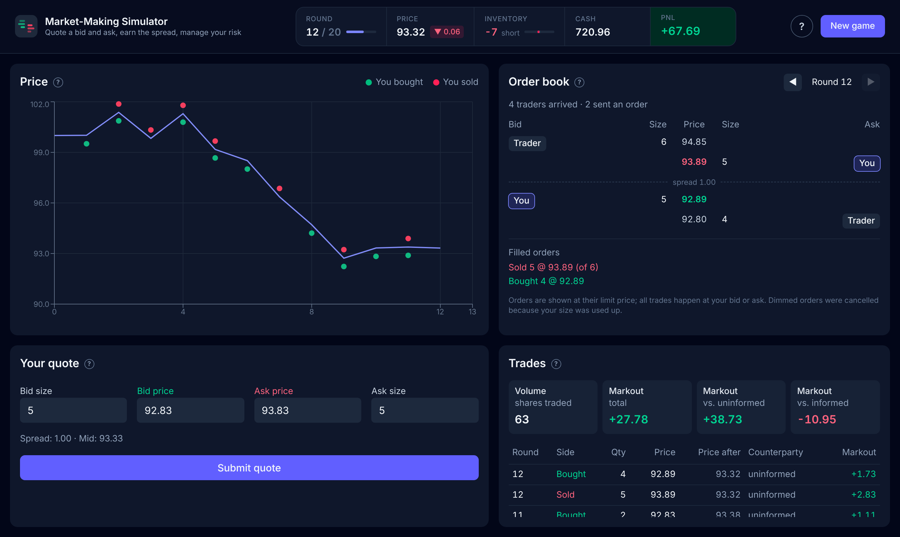

# Market-Making Simulator

A game in which you act as a market maker: quote a bid and an ask for a stock, trade against simulated
traders, and try to earn the spread without being picked off by informed traders.



## Getting started

Requirements: Python 3.10+ and Node.js 22+.

```bash
# Backend (http://localhost:8000, API docs at /docs)
python -m venv .venv
source .venv/bin/activate
pip install -r backend/requirements.txt
cd backend && uvicorn app.main:app --reload

# Frontend, in a second terminal (http://localhost:5173)
cd frontend && npm install && npm run dev
```

## How it works

Each round you set a bid and an ask with a size. A Poisson distributed number of traders arrives; each one buys at
your ask or sells at your bid if their valuation makes it worthwhile, and otherwise does nothing. Orders are
immediate-or-cancel and filled in order of arrival. Then the new price is revealed and your cash, inventory and PnL
are updated. Your score is your final PnL.

There are two types of traders:
- **Uninformed traders** value the stock around the current price and on average pay you the spread.
- **Informed traders** know roughly where the price is going, so they tend to trade with you just before it moves
  against you (adverse selection).

The challenge: a wider spread earns more per trade but attracts fewer traders, and inventory you hold is exposed to
price moves.

| Component  | Model                                                           |
| ---------- | --------------------------------------------------------------- |
| Price      | Geometric Brownian motion, one round = one trading day          |
| Arrivals   | Poisson distributed number of traders per round                 |
| Valuations | Next price (informed) or current price (uninformed) plus noise  |
| Order book | Price-time priority, tick size 0.01, immediate-or-cancel orders |

All parameters can be set before starting a game. 

## Project structure
The repository is structured as follows:

```
backend/
├── market/   game engine: price process, traders, order book, portfolio, session
├── modes/    holds the current game
└── app/      FastAPI schemas and routes
frontend/src/
├── api/          calls to the backend
├── hooks/        game state
└── components/   chart, order book, quote form, trades, dialogs
```

| Endpoint                  | Description                       |
| ------------------------- | --------------------------------- |
| `GET /api/game/defaults`  | Default game settings             |
| `POST /api/game`          | Start a new game                  |
| `GET /api/game`           | Current game state                |
| `POST /api/game/quote`    | Submit a quote and play one round |

Code style: `ruff format .` (backend) and `npm run format` (frontend).
